<p align="center">
  <picture>
    <source media="(prefers-color-scheme: dark)" srcset="https://raw.githubusercontent.com/fathialamre/ticketcher/main/screenshots/logo/ticketcher_logo_dark.png">
    
  </picture>
</p>

<p align="center">
  <a href="https://pub.dev/packages/ticketcher"></a>
  <a href="https://pub.dev/packages/ticketcher/score"></a>
  <a href="https://pub.dev/packages/ticketcher/score"></a>
  <a href="https://opensource.org/licenses/MIT"></a>
  
</p>

# Ticketcher

Ticket-shaped widgets for Flutter: event tickets, boarding passes, coupons,
receipts and badges. You describe the sections; Ticketcher cuts the notches,
draws the dividers and edges, and handles gradients, images, blur, stamps and
3D flips.

<p align="center">
  
</p>

## What's new in 2.3

| Flip ticket | Status stamps | RTL & Arabic | Expired state |
|:---:|:---:|:---:|:---:|
| 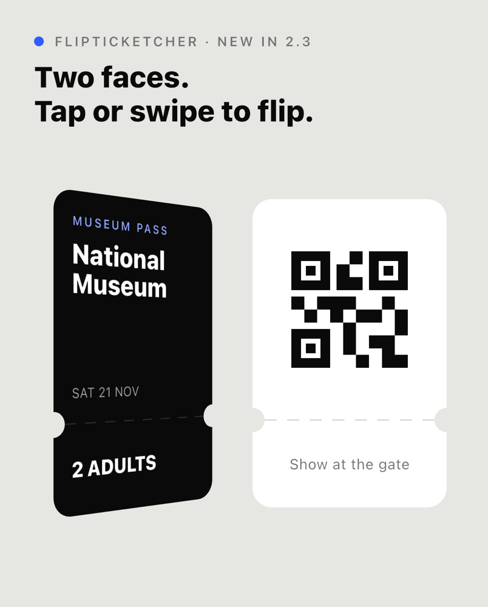 | 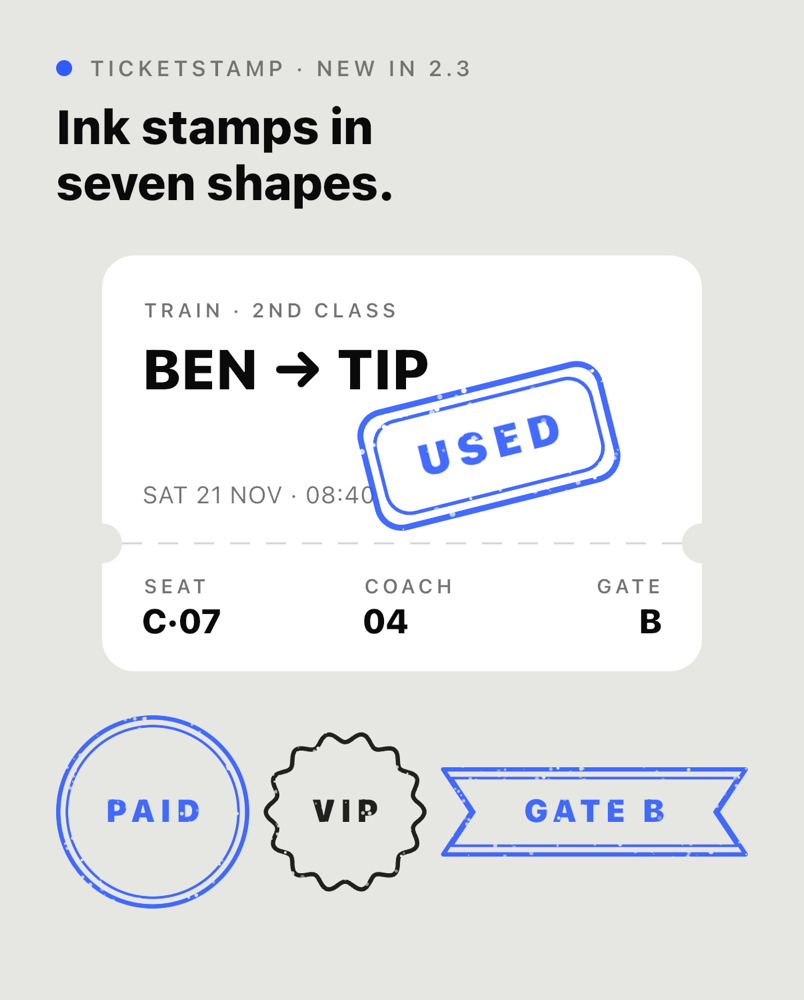 | 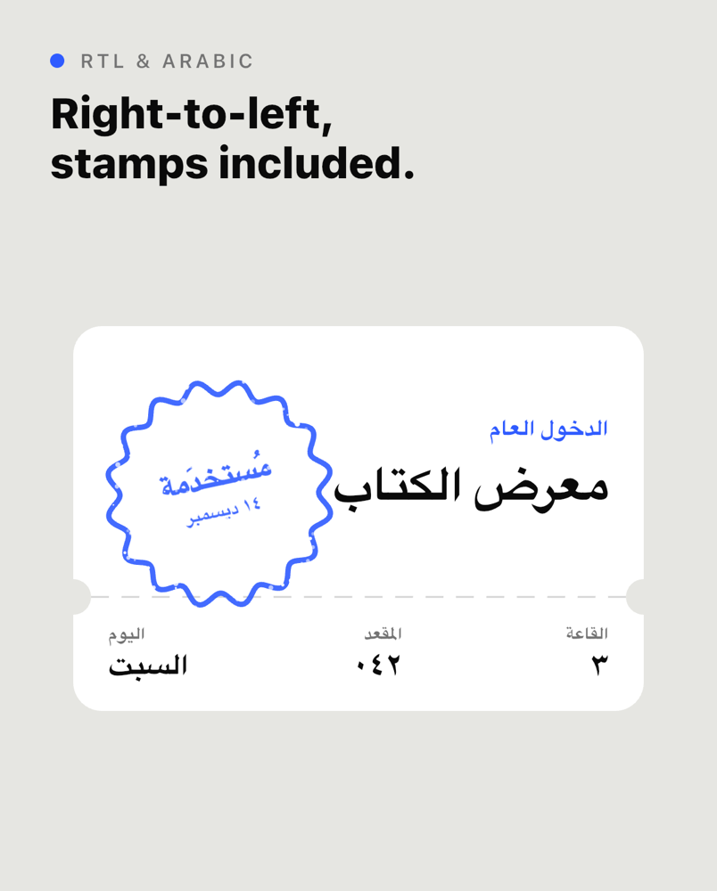 | 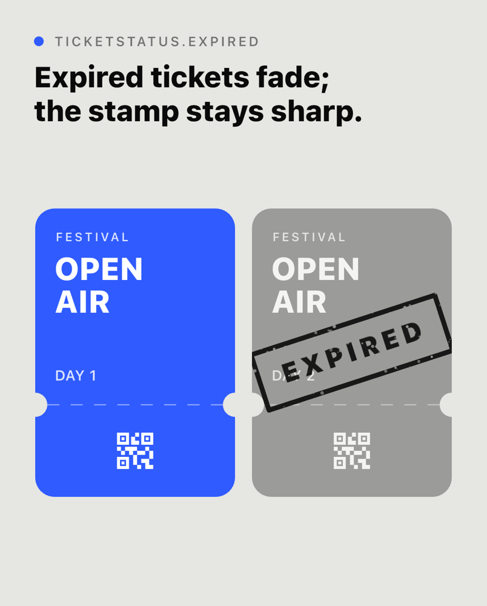 |
| [`FlipTicketcher`](#flip-ticket) | [`TicketStamp`](#status-stamps) | [RTL](#rtl-and-arabic) | [`TicketStatus`](#expired-tickets) |

## Contents

- [Installation](#installation)
- [Quick start](#quick-start)
- [Layout](#layout)
- New in 2.3: [Flip ticket](#flip-ticket) · [Status stamps](#status-stamps) · [Expired tickets](#expired-tickets) · [RTL and Arabic](#rtl-and-arabic)
- Shape: [Notches](#notches) · [Dividers](#dividers) · [Border patterns](#border-patterns) · [Corners](#corners)
- Fill: [Colored sections](#colored-sections) · [Gradients](#gradients) · [Image backgrounds](#image-backgrounds) · [Blur and glass](#blur-and-glass)
- Outline: [Borders](#borders) · [Stitching](#stitching) · [Shadows and punch holes](#shadows-and-punch-holes)
- Extras: [Watermarks](#watermarks) · [Stack effect](#stack-effect) · [Interaction](#interaction)
- [Rules and tips](#rules-and-tips) · [Example app](#example-app) · [Testing](#testing)

## Installation

```yaml
dependencies:
  ticketcher: ^2.3.0
```

```dart
import 'package:ticketcher/ticketcher.dart';
```

## Quick start

A ticket is a list of at least two `Section`s. Vertical is the default.

```dart
Ticketcher(
  width: 320,
  decoration: TicketcherDecoration(
    borderRadius: const TicketRadius(radius: 16),
    divider: TicketDivider.dashed(color: Colors.black26),
  ),
  sections: const [
    Section(padding: EdgeInsets.all(20), child: Text('BEN → TIP')),
    Section(padding: EdgeInsets.all(20), child: Text('Seat C·07')),
  ],
)
```

## Layout

<p align="center">
  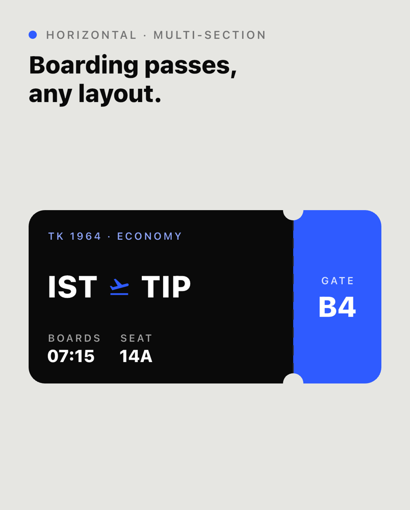
</p>

`Ticketcher.vertical` stacks sections top to bottom and `Ticketcher.horizontal`
lays them out left to right. In horizontal mode, `Section.widthFactor` splits the
width: factors `2.6` and `1` give a 2.6 : 1 ratio.

```dart
Ticketcher.horizontal(
  height: 170,
  decoration: TicketcherDecoration(
    backgroundColor: Colors.black,
    borderRadius: const TicketRadius(radius: 16),
    divider: TicketDivider.dashed(color: Colors.white24),
  ),
  sections: const [
    Section(widthFactor: 2.6, padding: EdgeInsets.all(18), child: FlightDetails()),
    Section(color: Color(0xFF2F5BFF), child: GateStub()),
  ],
)
```

| Widget parameter | What it does |
|---|---|
| `sections` | Two or more `Section`s. |
| `width` / `height` | Fixed size. Vertical tickets size their height to content; horizontal tickets need a `height`. |
| `notchRadius` | Size of the side notches at each section boundary (default `10`). |
| `decoration` | A `TicketcherDecoration` with everything visual below. |
| `onTap` | Tap handler for the whole ticket. |

`VTicketcher` and `HTicketcher` are the same widgets without the
`Ticketcher` wrapper.

## Flip ticket

<p align="center">
  
</p>

`FlipTicketcher` holds a `front` and a `back` and turns between them in 3D.
Both faces can be any widget; two tickets of the same size flip cleanest.

```dart
final flip = FlipTicketcherController();

FlipTicketcher(
  controller: flip,                    // flip.flip(), flip.showFront(), flip.showBack()
  trigger: FlipTrigger.tapOrSwipe,     // tap, swipe, tapOrSwipe or none
  axis: Axis.horizontal,               // Axis.vertical turns top over bottom
  duration: const Duration(milliseconds: 450),
  front: Ticketcher.vertical(sections: frontSections),
  back: Ticketcher.vertical(sections: backSections),
  onFlip: (isFront) => debugPrint('showing front: $isFront'),
)
```

A swipe follows the finger and settles on the nearest face, or flips on a fast
fling. The back face is never shown mirrored. When the system asks for reduced
motion, the faces swap without animating.

## Status stamps

<p align="center">
  
</p>

`TicketcherDecoration.stamp` draws an inked rubber stamp on top of the ticket,
clipped to its outline. Stamps never block taps on sections, and screen
readers announce their text.

```dart
Ticketcher(
  decoration: const TicketcherDecoration(
    stamp: TicketStamp.used(subtitle: '14 DEC 2026', animateIn: true),
  ),
  sections: sections,
)
```

Presets: `TicketStamp.used()`, `.voided()`, `.paid()` and `.vip()`. Each takes
`text`, `subtitle`, `color`, `rotation`, `alignment` and `animateIn`. For full
control, build one yourself:

```dart
const TicketStamp(
  text: 'GATE B',
  subtitle: 'BOARDING',
  shape: StampShape.ribbon,             // rectangle, roundedRectangle, circle, oval, seal, hexagon, ribbon
  borderStyle: StampBorderStyle.double, // single, double, dashed
  color: Color(0xFF2F5BFF),
  rotation: -14,                        // degrees
  alignment: Alignment(0.4, -0.2),
  offset: Offset.zero,
  opacity: 0.9,
  inkTexture: true,                     // worn-ink speckle
  animateIn: true,                      // thump in on first build
)
```

To show a stamp on its own, outside a ticket, use
`TicketStampMark(stamp: ...)`.

## Expired tickets

<p align="center">
  
</p>

Set `status: TicketStatus.expired` and the ticket turns grey and dim, and is
reported as disabled to screen readers. The stamp is drawn after the grey
filter, so it stays in full color.

```dart
TicketcherDecoration(
  status: TicketStatus.expired,
  stamp: const TicketStamp.voided(text: 'EXPIRED', color: Colors.black),
)
```

## RTL and Arabic

<p align="center">
  
</p>

Tickets follow the ambient `Directionality`, and stamp text works in any
script. When a stamp's text is Arabic, letter spacing is turned off so the
letters stay joined.

```dart
Directionality(
  textDirection: TextDirection.rtl,
  child: Ticketcher(
    decoration: const TicketcherDecoration(
      stamp: TicketStamp(
        text: 'مُستخدَمة',
        subtitle: '١٤ ديسمبر',
        shape: StampShape.seal,
        borderStyle: StampBorderStyle.single,
        alignment: Alignment(-0.8, -0.3),
        textStyle: TextStyle(fontSize: 16),
      ),
    ),
    sections: sections,
  ),
)
```

## Notches

<p align="center">
  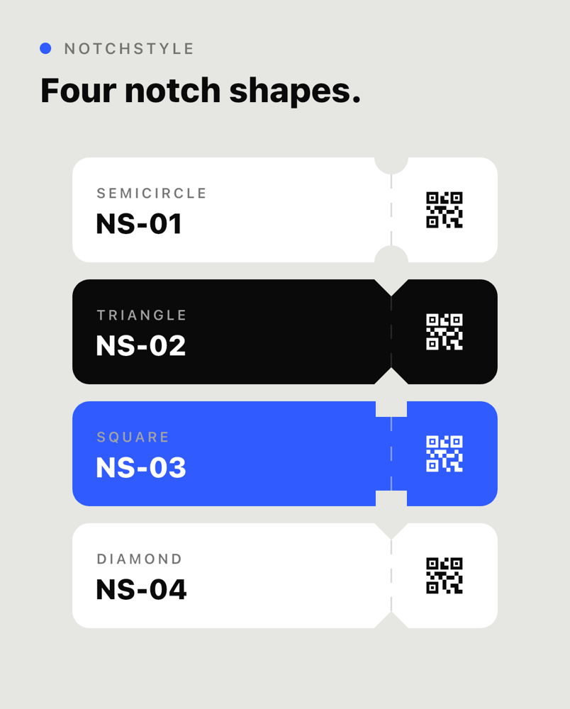
</p>

```dart
TicketcherDecoration(
  notchStyle: const NotchStyle.diamond(radius: 12), // semicircle, triangle, square, diamond
)
```

The widget's `notchRadius` sets the notch size when no `notchStyle` is given.

## Dividers

<p align="center">
  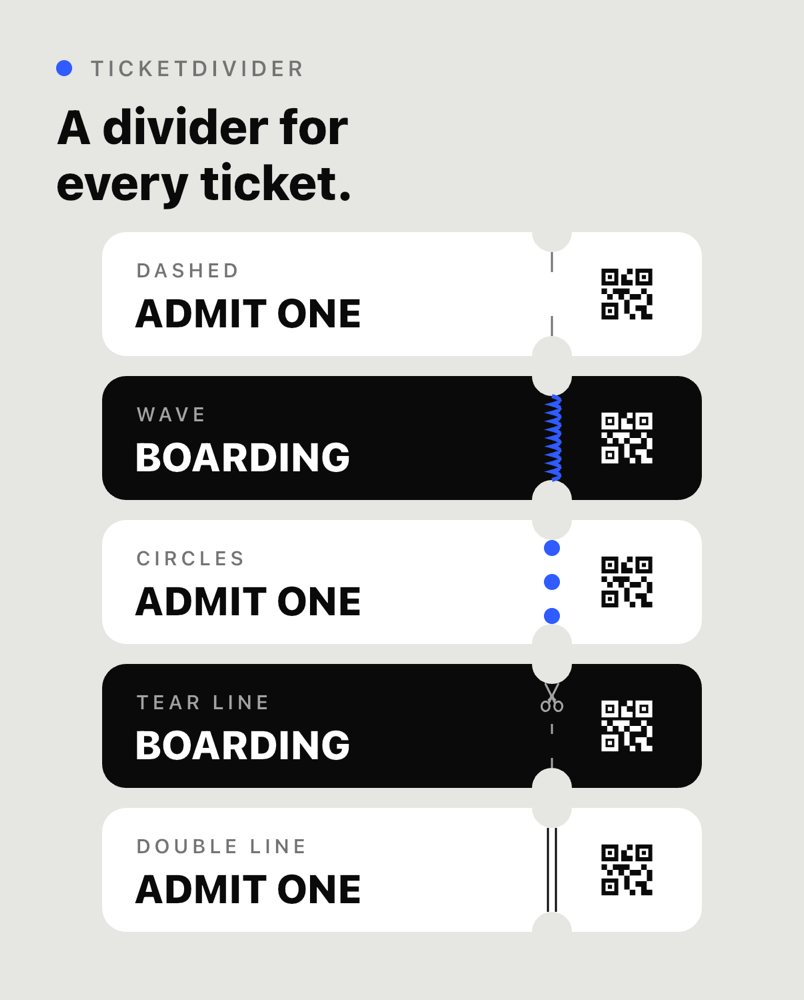
</p>

A divider is drawn at every boundary between sections:

```dart
TicketcherDecoration(divider: TicketDivider.dashed(color: Colors.grey))
```

| Constructor | Extra options |
|---|---|
| `TicketDivider.solid` | – |
| `TicketDivider.dashed` | `dashWidth`, `dashSpace` |
| `TicketDivider.dotted` | `dotSize`, `dotSpacing` |
| `TicketDivider.circles` | `circleRadius`, `circleSpacing` |
| `TicketDivider.wave` | `waveHeight`, `waveWidth` |
| `TicketDivider.smoothWave` | `waveHeight`, `waveWidth` |
| `TicketDivider.doubleLine` | `lineSpacing` |
| `TicketDivider.tearLine` | `dashWidth`, `dashSpace`, `scissorsSize` |
| `TicketDivider.gradientSolid` | required `gradient` |
| `TicketDivider.gradientDashed` | required `gradient`, `dashWidth`, `dashSpace` |

Every style also takes `color` (except the gradient ones), `thickness` and
`padding`. To use a different style at one boundary, set `dividerAfter` on the
section before it:

```dart
sections: [
  Section(child: header, dividerAfter: TicketDivider.tearLine(color: Colors.grey)),
  Section(child: body, dividerAfter: TicketDivider.smoothWave(color: Colors.blue)),
  Section(child: stub),
]
```

## Border patterns

<p align="center">
  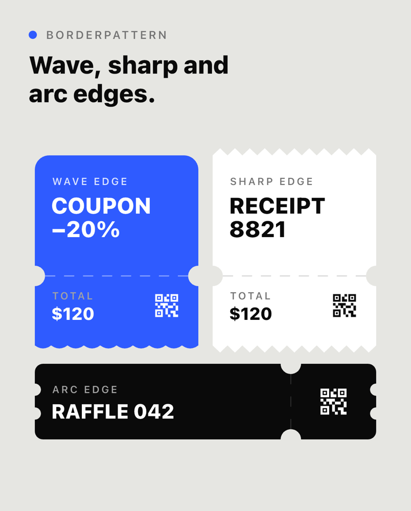
</p>

Cut a pattern into an outer edge: `BorderShape.wave`, `.sharp` or `.arc`.

```dart
TicketcherDecoration(
  borderRadius: const TicketRadius(radius: 14, corner: TicketCorner.top),
  bottomBorderStyle: const BorderPattern(shape: BorderShape.wave, height: 6, width: 16),
)
```

- `topBorderStyle` and `bottomBorderStyle` work on vertical tickets.
- `leftBorderStyle` and `rightBorderStyle` work on horizontal tickets.
- The corners on a patterned edge must be square (asserted on vertical
  tickets). Round only the other corners, or use `TicketRadius.zero`.

## Corners

```dart
const TicketRadius(
  radius: 16,
  corner: TicketCorner.all,          // all, top, bottom, topLeft, topRight, bottomLeft, bottomRight, none
  direction: RadiusDirection.inward, // inward (scooped) or outward (rounded)
)
```

## Colored sections

<p align="center">
  
</p>

```dart
sections: const [
  Section(color: Colors.black, child: header),
  Section(color: Color(0xFF2F5BFF), child: details),
  Section(color: Colors.white, child: passenger),
]
```

A section's `color` overrides the decoration's `backgroundColor` for that
section only.

## Gradients

<p align="center">
  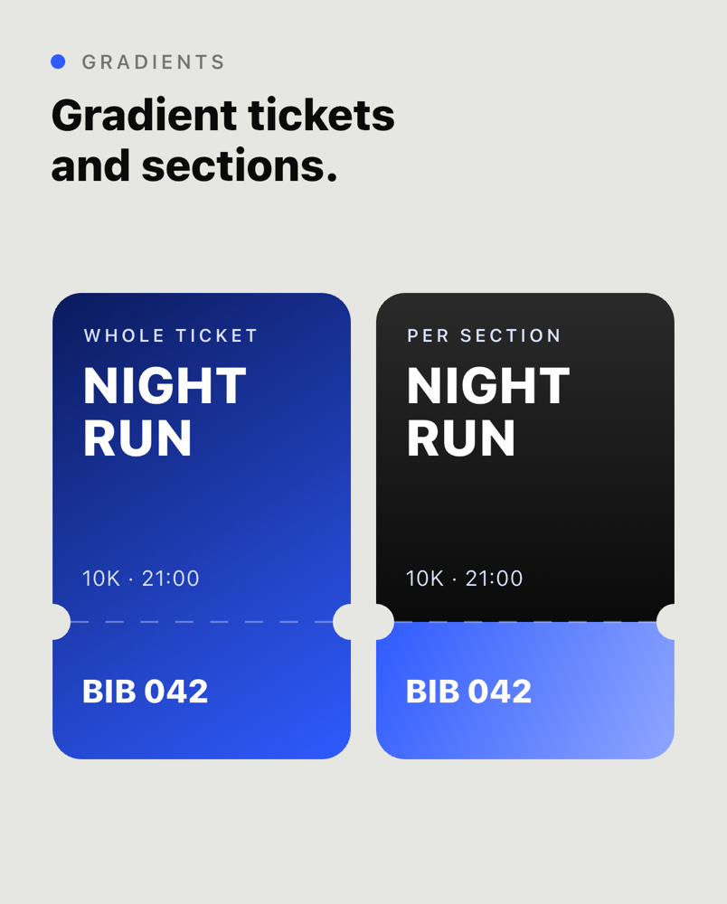
</p>

Fill the whole ticket with `decoration.gradient`, or give each section its
own `Section.gradient`. Linear, radial and sweep gradients all work.

```dart
// Whole ticket
TicketcherDecoration(
  gradient: const LinearGradient(colors: [Color(0xFF0B1A5C), Color(0xFF2F5BFF)]),
)

// Per section
Section(
  gradient: const LinearGradient(colors: [Color(0xFF2A2A2A), Colors.black]),
  child: header,
)
```

A section's `gradient` takes precedence over its `color`.

## Image backgrounds

<p align="center">
  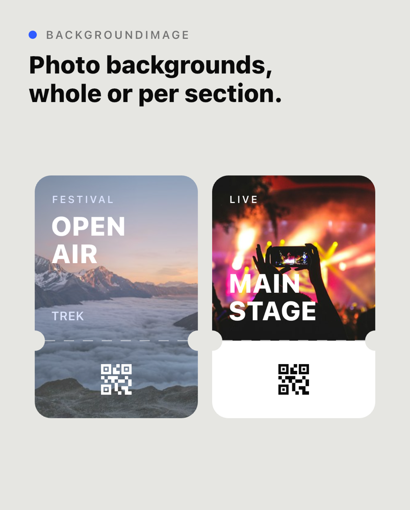
</p>

```dart
// Whole ticket
TicketcherDecoration(
  backgroundColor: Colors.black,
  backgroundImage: const NetworkImage('https://…/mountains.jpg'),
  backgroundImageOpacity: 0.75,
  backgroundImageFit: BoxFit.cover,
  backgroundImageAlignment: Alignment.center,
)

// One section
Section(
  backgroundImage: const AssetImage('assets/stage.jpg'),
  child: header,
)
```

Any `ImageProvider` works. With an opacity below 1, the `backgroundColor` shows
through, so a dark color keeps light text readable.

## Blur and glass

<p align="center">
  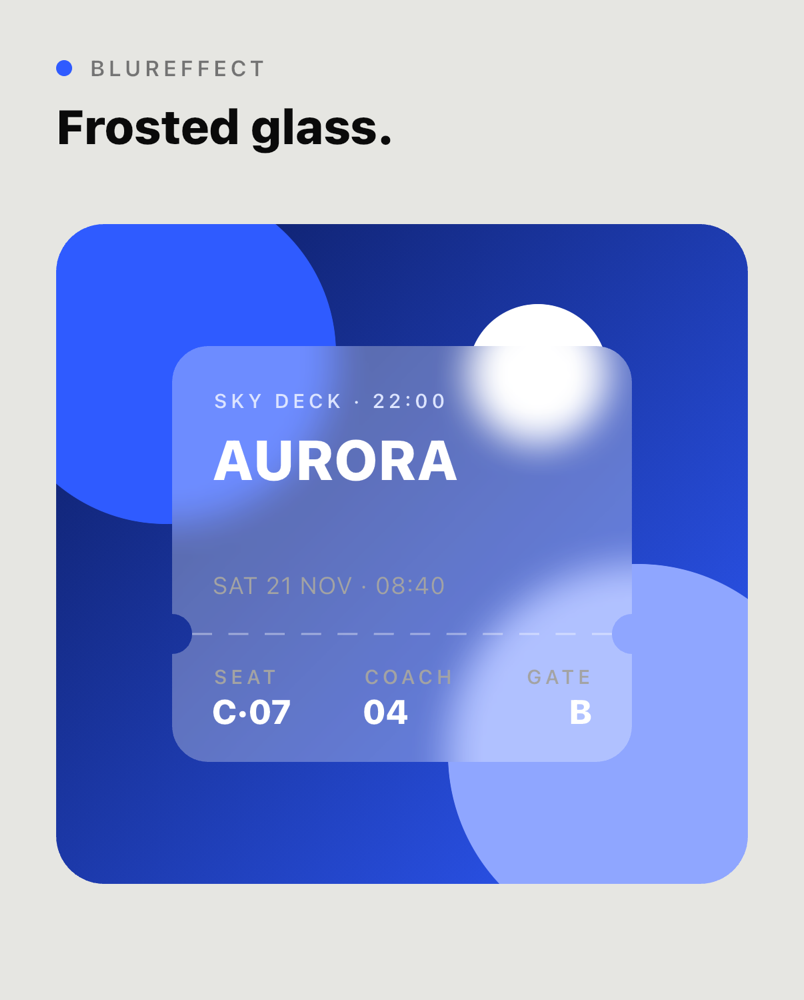
</p>

```dart
TicketcherDecoration(
  backgroundColor: Colors.white.withValues(alpha: 0.12),
  blurEffect: const BlurEffect.frosted(), // sigma, tintColor, opacity
)
```

| Constructor | Effect |
|---|---|
| `BlurEffect.backdrop(sigma:)` | Blurs whatever is behind the ticket. |
| `BlurEffect.frosted(sigma:, tintColor:, opacity:)` | Backdrop blur plus a tint, for glassmorphism. |
| `BlurEffect.gaussian(sigma:)` | Blurs the ticket's own content. |

Backdrop blur only shows when something sits behind the ticket, such as an
image, gradient or shapes.

## Borders

<p align="center">
  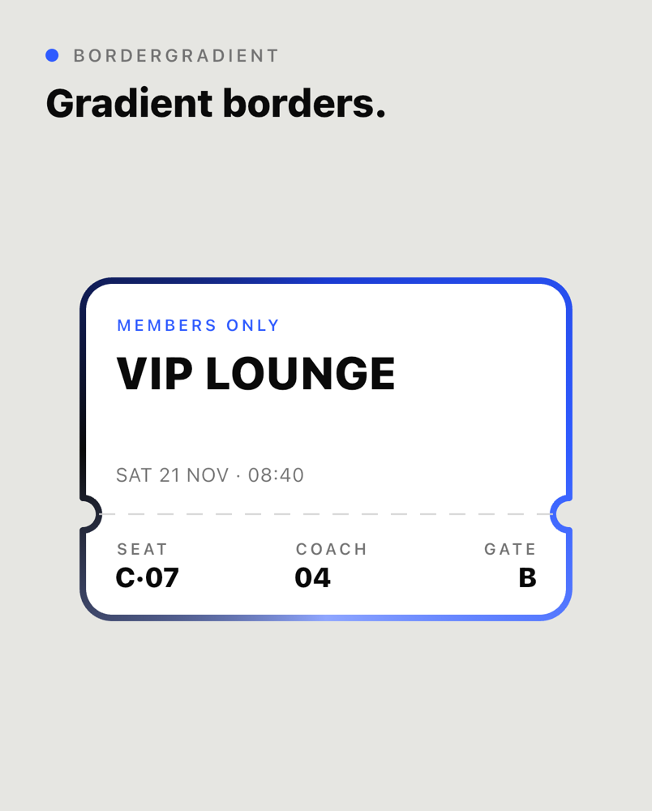
</p>

```dart
// Solid
TicketcherDecoration(border: Border.all(color: Colors.black, width: 2))

// Gradient
TicketcherDecoration(
  borderWidth: 4,
  borderGradient: const SweepGradient(
    colors: [Color(0xFF2F5BFF), Color(0xFF8FA6FF), Colors.black, Color(0xFF2F5BFF)],
  ),
)

// Dashed cut-line: needs border or borderGradient
TicketcherDecoration(
  border: Border.all(color: const Color(0xFF2F5BFF), width: 2),
  borderDash: const BorderDash(dash: 8, gap: 5),
)
```

Borders follow the notches, corners and edge patterns.

## Stitching

<p align="center">
  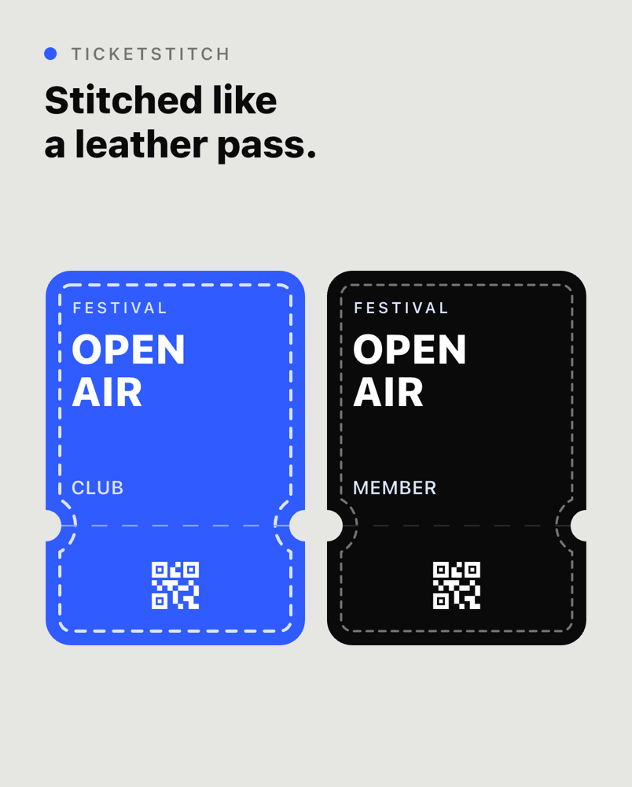
</p>

An inset dashed thread that follows the whole outline, like a sewn leather
pass:

```dart
TicketcherDecoration(
  stitch: const TicketStitch(
    color: Colors.white,
    inset: 9,          // distance from the edge
    length: 6,         // dash length
    spacing: 6,        // gap between dashes
    thickness: 2,
    cap: StrokeCap.round,
  ),
)
```

## Shadows and punch holes

<p align="center">
  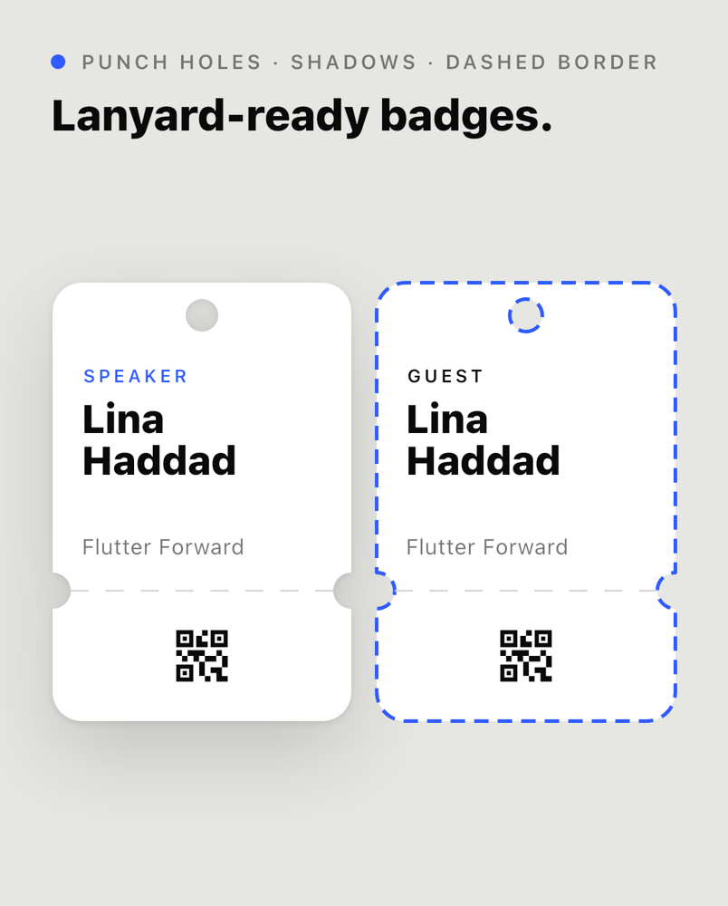
</p>

```dart
TicketcherDecoration(
  shadows: [
    BoxShadow(color: Colors.black.withValues(alpha: 0.10), blurRadius: 2, offset: const Offset(0, 1)),
    BoxShadow(color: Colors.black.withValues(alpha: 0.16), blurRadius: 30, offset: const Offset(0, 18)),
  ],
  punchHoles: const [
    PunchHole(alignment: Alignment.topCenter, offset: Offset(0, 18), radius: 9),
  ],
)
```

- `shadows` layers several shadows. It wins over the single `shadow` when both
  are set, and `shadows: []` turns shadows off. `spreadRadius` isn't applied.
- Punch holes are real cutouts. The background, shadows, blur and border all
  respect them. A hole's `shape` takes the same `NotchShape` values as notches.

## Watermarks

<p align="center">
  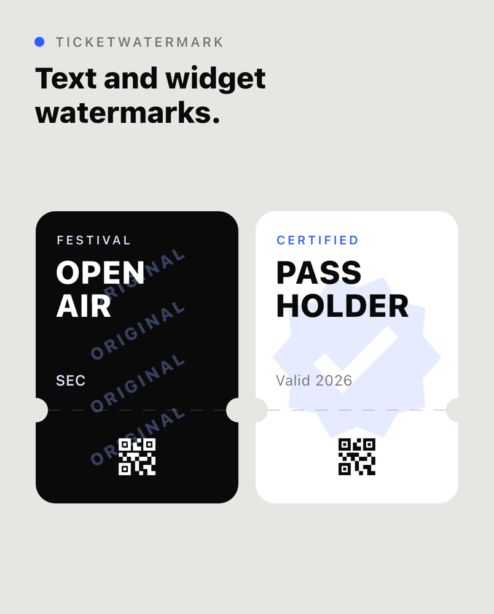
</p>

```dart
// Repeating text
TicketcherDecoration(
  watermark: const TicketWatermark.text(
    text: 'ORIGINAL',
    style: TextStyle(fontSize: 14, fontWeight: FontWeight.w800),
    opacity: 0.35,
    rotation: 330,      // degrees, 0 to 360
    repeat: true,
    repeatSpacing: 26,
  ),
)

// Any widget
TicketcherDecoration(
  watermark: const TicketWatermark.widget(
    widget: Icon(Icons.verified, size: 150),
    width: 150,
    height: 150,
    opacity: 0.12,
    alignment: WatermarkAlignment.center, // topLeft … bottomRight
  ),
)
```

## Stack effect

<p align="center">
  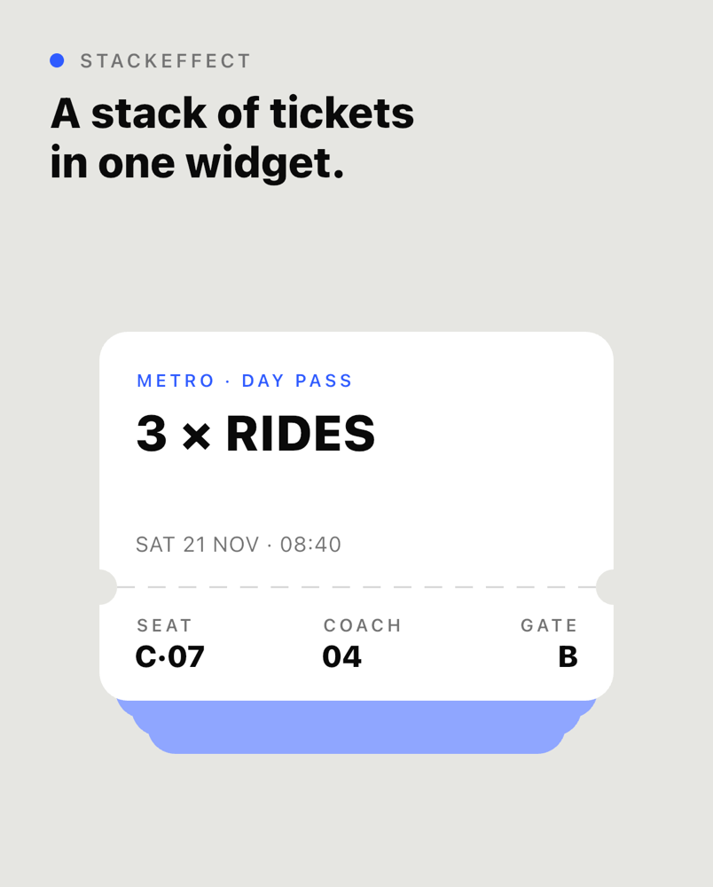
</p>

Draws layers peeking out under a vertical ticket, like a pad of tickets:

```dart
TicketcherDecoration(
  stackEffect: const StackEffect(
    count: 3,       // up to StackEffect.maxCount (3)
    offset: 10,     // vertical step between layers
    widthStep: 18,  // how much narrower each layer is
    color: Color(0xFF8FA6FF),
  ),
)
```

## Interaction

Give a section its own `onTap`, and the ticket an `onTap` for everything
else. A section's handler wins when its area is tapped.

```dart
Ticketcher(
  onTap: () => openTicket(),
  sections: [
    Section(child: header, onTap: () => showDetails()),
    Section(child: checkInButton, onTap: () => checkIn()),
  ],
)
```

Sections without `onTap` don't react to taps.

## Rules and tips

These configurations fail with an assertion in debug builds:

- Fewer than two sections.
- On a vertical ticket, a `topBorderStyle` or `bottomBorderStyle` on an edge
  whose corners are rounded.
- An opacity outside 0–1 (stamps, watermarks, blur, background images).
- A watermark `rotation` outside 0–360.
- A `StackEffect.count` above 3.
- A zero or negative size: notch radius, stamp `borderWidth`, `BorderDash`
  dash or gap, or `TicketStitch` measurements.

Tips:

- `borderDash` only draws when `border` or `borderGradient` is set.
- Give horizontal tickets a `height`, and set `width` when you know it. A
  fixed size saves layout work.
- Use the same color family for the divider and the border, and keep dividers
  thinner than the border.
- Put backdrop-blur tickets over something with texture, or the blur won't
  show.

## Example app

The [`example`](example) app has a page for every feature, all in one
black-white-blue theme. The screenshots in this README come from
[`example/lib/readme_shots.dart`](example/lib/readme_shots.dart). With an iPhone
16 Pro simulator booted, regenerate them with:

```bash
cd example && tool/capture_readme_shots.sh
```

## Testing

```bash
flutter test
```

The tests cover every public model (equality, `copyWith`, assertions), the
painters and clippers, stamps and the expired state, the flip widget
(gestures, controller, reduced motion), and smoke tests for both layouts.

## Contributing

Issues and pull requests are welcome.

## License

MIT. See [LICENSE](LICENSE).
